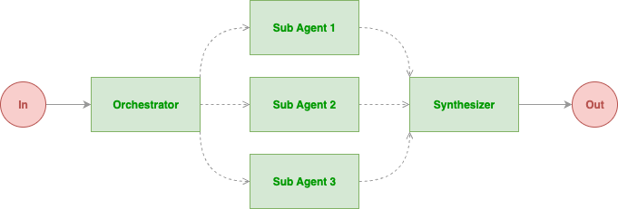

# ModelDeployAgent
## Tools
- Initial idea for tool building
  - use `ToolFileList.py` to get the current code hierarchy
  - use `ToolGraphAnalysis.py` to analyze the code functions calling graph structure
  - build another `ToolDependencyAnalysis.py` to analyze the code module dependency structure
  - it is better to get `.json` format graph data for agent analysis

## Agent Roles
- React agent
  - The core for "Think-Act".
  - Responsible for decomposing tasks, planning actions, and executing tools.
- User agent
  - Interface between the user and the React agent.
  - Receives user input and conveys it to the React agent.

## Formatter
- `DashScopeChatFormatter`: user-agent conversation formatter
- `DashScopeMultiAgentFormatter`: (collect) multi-agent conversation formatter

## Workflow
- Conversation
  - User-Assistant interaction 
  - Multi-agent conversation
- Debate
  - Multi user-like agent + Coordinator agent
  - Users propose different opinions on the same topic, and the Coordinator summarizes and evaluates these opinions with `structured_model` (like structure output, `bool` type)
  - [link](https://doc.agentscope.io/zh_CN/tutorial/workflow_multiagent_debate.html)
- Concurrent
  - Concurrently run multiple agents to handle different tasks
- Routing
  - Explicitly Routing
  - Implicitly Routing
- Handsoff
  - 

## Agent Components
- Memory
  - you can add/delete `Msg` memory for an agent
- Memory Pattern
  - `agent_control`: agent autonomous control
  - `static_control`: developer control
- Long Term Memory
  - `record`: record (write in) some memory permanently
  - `retrieve`: retrieve some memory when needed
- Interrupt
  - Interrupt an agent's reply
  - `handle_interrupt`: handle interrupt logic
- Pipeline
- Plan
- RAG
- Snapshot
  - snapshot an agent's state at a specific time point
- Session save/load
- **Server with MCP service**
  - Detailed usage?
  - Call tool from the server
- Token Counting
## MLOPs practices
- [Google Cloud](https://docs.cloud.google.com/architecture/mlops-continuous-delivery-and-automation-pipelines-in-machine-learning?hl=zh-cn)