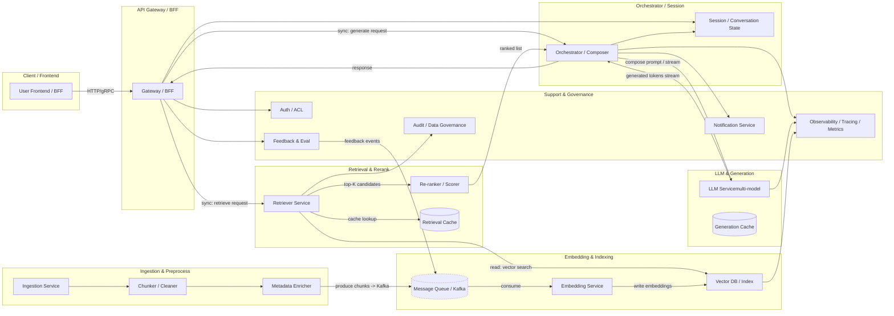

# RAG 服务拆分拓扑图

下面在一张图中展示拆分后的微服务拓扑（包含同步/异步交互、消息队列、向量存储、观测与治理）。图使用 Mermaid 格式，图下方补充每个组件的职责、典型 API、以及关键可观测性指标和故障应对要点。

---

## 图下说明（每个组件要点）

### API Gateway / BFF

* **职责**：鉴权、速率限制、路由、聚合、短路降级展示（cache fallback）。
* **典型 API**：`/v1/retrieve`, `/v1/generate`, `/v1/session/{id}`。
* **SLO 指标**：P95 latency、错误率、请求速率。

### Ingestion Service

* **职责**：抓取原始文档、清洗、chunking、metadata enrichment、发送到消息队列。
* **交互**：完全异步，向 Kafka/队列写入 `Chunk` 事件。
* **注意**：记录原文 id 与 chunk lineage，做 PII 检测与 redaction。

### Embedding Service

* **职责**：批量/流式向量化（支持 model_id/version）、写入 Vector DB。
* **要求**：幂等写入（request_id）、backpressure 处理、重试与 DLQ（Dead Letter Queue）。

### Vector DB / Index

* **职责**：存储向量、执行 ANN 搜索、支持过滤（metadata-level ACL）。
* **SLO 指标**：query latency P95、index staleness、QPS、存储利用率。
* **运维要点**：支持 index snapshot 与回滚，分片/副本策略。

### Retriever Service

* **职责**：接受查询，结合 BM25 / vector mix 做 hybrid retrieval，返回 candidates + provenance。
* **优化**：前置缓存（LRU）、metadata filter、短路快速失败策略。

### Re-ranker / Scorer

* **职责**：对 top-K 做更高成本的 cross-encoder 打分或融合业务信号，输出 final ranked list。
* **部署**：可按需横向扩展，且通常异步或并行调用以控制尾延迟。

### Orchestrator / Composer

* **职责**：生成 prompt、决定多轮检索或多模型路由、管理生成流程（包括流式返回）。
* **与 Session 的关系**：读取/写入会话上下文，维护短期缓存的 retrieval snapshot id。

### LLM Service

* **职责**：托管不同规模模型，支持流式输出、幂等调用、cost 控制（分级模型策略）。
* **可用性策略**：模型副本、降级到 cheaper model、请求排队 + 超时策略。

### Session / Conversation State

* **职责**：保存会话上下文、短期检索快照、用户偏好、安全标签。
* **数据策略**：短期缓存（低延迟 db like Redis）+ 长期日志写入（用于回放）。

### Feedback / Eval

* **职责**：记录用户反馈、自动化评价（precision@k、RAGAS）、离线回放训练数据。
* **交互**：将评估事件写回消息队列，触发 re-index 或模型调优 pipelines。

### Auth / Audit / Data Governance

* **职责**：每次检索/生成做权限检查，维护审计链与合规记录，处理 PII 策略。

### Observability（必须）

* **包含**：Tracing (OpenTelemetry)、Metrics (Prometheus)、Logs (ELK/Datadog)、业务指标仪表盘（precision@k、hallucination rate）。

---

## 部署与通信要点（工程建议）

1. **同步调用（低延迟路径）**：Retriever → Re-ranker(可选) → Orchestrator → LLM 应支持短超时与熔断。2. **异步管道（高吞吐/批处理）**：Ingestion → Embedding → VectorDB 使用 Kafka，确保至少一次且写入幂等。3. **缓存层**：在 Retriever 与 Orchestrator 之间放置缓存，加速常见查询。4. **降级策略**：当 VectorDB/LLM 不可用时，API Gateway 返回 cache fallback 或 soft-answer，并把请求入队回放。5. **安全**：对 chunk metadata 强制 ACL 过滤，LLM 返回必须附上 provenance 信息供审计。

---

## 可导出和下一步

* 如果你希望，我可以把上述 Mermaid 图导出为 **PNG/SVG**，或把文档转成 **PDF**（含图和说明）。
* 也可以把图拆成更细粒度的两张：**实时路径图**（Retriever→LLM）与**离线路径图**（Ingestion→Embedding→Indexing）。

---

*注：图中仅展示核心组件与典型交互，细节（如缓存拓扑、负载均衡器、CDN、内部监控 agent）可按需加入。*
